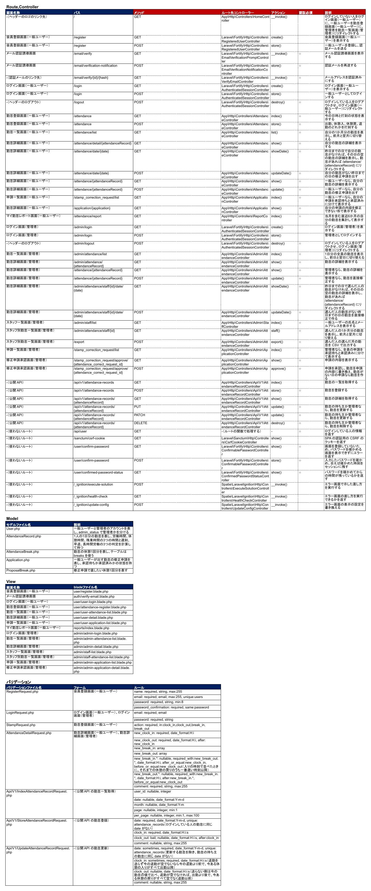
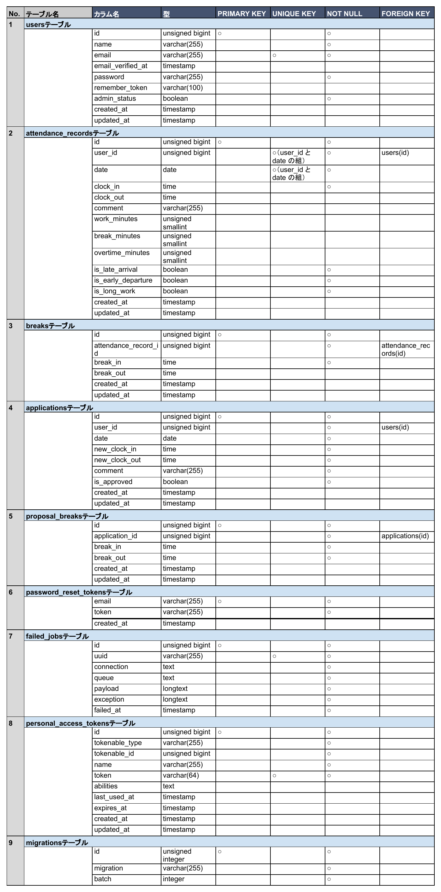
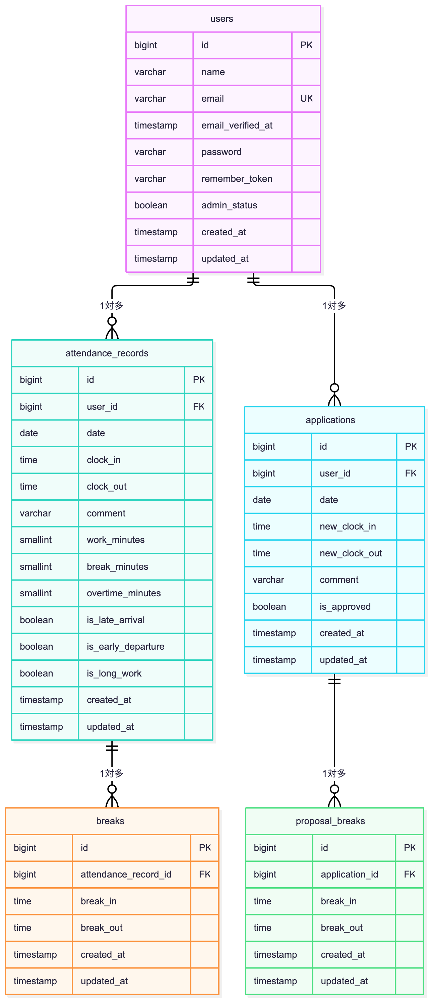

# coachtech 勤怠管理アプリ

## 概要

出勤、休憩、退勤の打刻で日々の勤怠を記録する勤怠管理アプリです。一般ユーザーは自分の勤怠の打刻と修正申請を行い、管理者は一般ユーザー全員の勤怠の確認と修正、修正申請の承認を行います。

## 実装機能

「API 利用者」は、公開 API を呼ぶ外部アプリケーションを指します。「スタッフ」は、一般ユーザーを指します。

| 利用者 | 機能 | 概要 |
|---|---|---|
| 一般ユーザー | 会員登録 | 名前、メールアドレス、パスワードで一般ユーザーを登録する |
| 一般ユーザー | メール認証 | 会員登録の後に届くメールのリンクでメールアドレスを認証する |
| 一般ユーザー | ログイン | メールアドレスとパスワードでログインする |
| 一般ユーザー | ログアウト | ログイン状態を解除する |
| 一般ユーザー | 勤怠打刻 | 出勤、休憩入、休憩戻、退勤を打刻する |
| 一般ユーザー | 勤怠一覧表示 | 自分の勤怠を月ごとに表示する |
| 一般ユーザー | 勤怠詳細表示 | 自分の1日の勤怠の詳細を表示する |
| 一般ユーザー | 修正申請 | 勤怠詳細の画面から自分の勤怠の修正を申請する |
| 一般ユーザー | 申請一覧表示 | 自分の申請を承認待ちと承認済みに分けて表示する |
| 一般ユーザー | マイ勤怠レポート表示 | 自分の当月の勤怠の統計と過去6か月の推移を表示する |
| 管理者 | ログイン | メールアドレスとパスワードでログインする |
| 管理者 | ログアウト | ログイン状態を解除する |
| 管理者 | 勤怠一覧表示 | スタッフ全員の1日の勤怠を表示する |
| 管理者 | 勤怠詳細表示 | スタッフの1日の勤怠の詳細を表示する |
| 管理者 | 勤怠直接修正 | 勤怠詳細の画面からスタッフの勤怠を直接修正する |
| 管理者 | スタッフ一覧表示 | スタッフの名前とメールアドレスを表示する |
| 管理者 | スタッフ別勤怠一覧表示 | スタッフ1人の勤怠を月ごとに表示する |
| 管理者 | CSV 出力 | スタッフ1人の1か月の勤怠を CSV でダウンロードする |
| 管理者 | 申請一覧表示 | スタッフ全員の申請を承認待ちと承認済みに分けて表示する |
| 管理者 | 修正申請承認 | スタッフの修正申請の内容を確かめて承認する |
| API 利用者 | 勤怠一覧取得 | 勤怠の一覧をページネーション付きで取得する |
| API 利用者 | 勤怠詳細取得 | 1件の勤怠を休憩と修正申請を含めて取得する |
| API 利用者 | 勤怠登録 | 勤怠を1件登録する |
| API 利用者 | 勤怠更新 | 1件の勤怠の全部か一部の項目を更新する |
| API 利用者 | 勤怠削除 | 1件の勤怠を削除する |

## 環境構築

### 前提

- Docker がインストールされ、起動していること

### 手順

Laravel Sail のコマンドは `./vendor/bin/sail` で記載しています。`sail` のエイリアスを設定している場合は、`sail` と読み替えてください。

1. リポジトリをクローンする

   ```bash
   git clone https://github.com/m-murayama0327/attendance-app.git
   ```

2. プロジェクトのディレクトリに移動する

   ```bash
   cd attendance-app
   ```

3. Composer のパッケージをインストールする

   `vendor` はリポジトリに含めていないため、Laravel Sail を使う前に Docker でインストールします。

   ```bash
   docker run --rm \
     -u "$(id -u):$(id -g)" \
     -v "$(pwd):/var/www/html" -w /var/www/html \
     -e COMPOSER_CACHE_DIR=/tmp/composer_cache \
     laravelsail/php82-composer:latest \
     composer install
   ```

4. `.env` を作る

   ```bash
   cp .env.example .env
   ```

5. コンテナを起動する

   ```bash
   ./vendor/bin/sail up -d
   ```

6. アプリケーションキーを作る

   ```bash
   ./vendor/bin/sail artisan key:generate
   ```

7. テーブルを作り、初期データを入れる

   ```bash
   ./vendor/bin/sail artisan migrate --seed
   ```

8. フロントエンドのパッケージをインストールする

   ```bash
   ./vendor/bin/sail npm install
   ```

9. Vite の開発用のサーバーを起動する

   画面を確かめる間は、Vite の開発用のサーバーを起動したままにします。

   ```bash
   ./vendor/bin/sail npm run dev
   ```

## 動作確認

### 開発環境 URL

| 対象 | URL |
|---|---|
| アプリ | http://localhost |
| Mailpit | http://localhost:8025 |
| phpMyAdmin | http://localhost:8080 |

### ログイン用アカウント

初期データとして、次のアカウントが登録されています。どのアカウントも、メール認証済みです。

user1 には、要件の「user1 の意図的データ」のとおり、今月の平日17日分の勤怠が入っています。この17日にはシーダーを動かした日より後の日も含まれることがあり、そのような日には勤怠がすでにあるため、user1 では打刻できません。

| 利用者 | メールアドレス | パスワード |
|---|---|---|
| 管理者 | user3@example.com | password |
| 一般ユーザー | user1@example.com | password |
| 一般ユーザー | user2@example.com | password |
| 一般ユーザー | user4@example.com | password |
| 一般ユーザー | user5@example.com | password |
| 一般ユーザー | user6@example.com | password |
| 一般ユーザー | user7@example.com | password |

### テスト実行

2026-11-28 に PHP 8.5.8 で実行した結果は、574件のテストのうち572件が passed、2件が deprecated で、failed は0件でした。deprecated の2件は、Laravel の初期ファイルの `config/database.php` にある `PDO::MYSQL_ATTR_SSL_CA` が PHP 8.5 で非推奨になったために表示される警告で、テストの失敗ではありません。

環境構築の手順の後に、次のコマンドで実行します。テストは、MySQL のコンテナが作るテスト用のデータベース（`testing`）を使います。

```bash
./vendor/bin/sail artisan test
```

## 使用技術

Laravel Sail、Laravel、Laravel Fortify、Laravel Sanctum、Vite のバージョンは、`composer.lock` と `package-lock.json` が固定した版です。PHP は Laravel Sail の 8.5 の実行環境が決める版で、MySQL、Mailpit、phpMyAdmin は Docker のイメージが決める版です。PHP と MySQL は細かい版（8.5.x、8.4.x）までは固定しておらず、Mailpit と phpMyAdmin はその時点の最新版（latest）を使います。開発では PHP 8.5.8、MySQL 8.4.13 で動作を確かめました。

| 分類 | 技術 | バージョン |
|---|---|---|
| 開発環境 | Laravel Sail | 1.69.0 |
| 開発言語 | PHP | 8.5 |
| フレームワーク | Laravel | 10.50.3 |
| 認証ライブラリ | Laravel Fortify | 1.36.2 |
| 認証ライブラリ | Laravel Sanctum | 3.3.3 |
| データベース | MySQL | 8.4 |
| ビルドツール | Vite | 5.4.21 |
| 開発ツール | Mailpit | latest |
| 開発ツール | phpMyAdmin | latest |

## 基本設計書



## テーブル仕様書

### テーブル定義



### ER図

業務テーブル5件の関連を示す ER図です。Laravel の基盤テーブル4件は省略しています。

ユーザーは勤怠と申請を複数持ちます。勤怠は休憩を複数持ち、申請は直したい休憩の時刻を複数持ちます。申請は勤怠を外部キーで指さず、申請者と対象日で勤怠と紐づけています。



## API エンドポイント

勤怠の取得（GET）は認証なしで使えます。一方、登録、更新、削除は、Sanctum のトークンでの認証が必要です。認証していないとき（401）は `{"message": "Unauthenticated."}` を返し、権限がないとき（403）と勤怠がないとき（404）はエラーを `{"error": "..."}` の形の JSON で返します。

| メソッド | パス | 概要 |
|---|---|---|
| GET | /api/v1/attendance-records | 勤怠の一覧をページネーション付きで取得する |
| GET | /api/v1/attendance-records/{attendanceRecord} | 1件の勤怠を休憩と修正申請を含めて取得する |
| POST | /api/v1/attendance-records | 勤怠を1件登録する |
| PUT / PATCH | /api/v1/attendance-records/{attendanceRecord} | 1件の勤怠の全部か一部の項目を更新する |
| DELETE | /api/v1/attendance-records/{attendanceRecord} | 1件の勤怠を削除する |

## 補足

### 要件相違点

次の表は、要件（要件シート、Figma、提供された Blade と CSS、コーディング規約）の記載と異なる点です。いずれも担当コーチに確認済みです。

| 対象 | 要件 | 実装 | 理由 |
|---|---|---|---|
| PHP のバージョン | プロジェクト概要は、開発言語を PHP 8.2 とする | PHP 8.5 を使う | 環境構築手順のとおりに Laravel Sail を入れると、PHP 8.5 の実行環境になるため |
| 勤怠打刻の休憩開始ボタン名 | 機能要件（FN021）は、ボタンの名前を「休憩」と「休憩入」の2通りで書く | ボタンの名前を「休憩入」にする | 提供された Blade とテストケース一覧が「休憩入」のため |
| 勤怠一覧表示とスタッフ別勤怠一覧表示の未登録日詳細リンク | 提供された Blade は、勤怠がない行に「詳細」を出さない | 昨日までの勤怠がない日の行にも「詳細」を出す | 打刻を忘れた日も勤怠を直せるようにするため |
| 勤怠詳細表示と修正申請承認の休憩行 | 提供された Blade は、追加用の空の休憩の行にも「〜」を出す | 追加用の空の休憩の行には「〜」を出さない | 空の行に「〜」だけが出ないようにするため |
| 一般ユーザーの申請一覧表示の承認済み申請詳細 | 提供された Blade は、承認待ちの申請だけを出す | 承認済みの申請も読み取り専用で出す | 同じ日に2回以上申請したときに、前の申請を確かめられるようにするため |
| 管理者の勤怠一覧表示の未登録者 | 提供された Blade は、勤怠がある人だけを出す | 勤怠がない人も出勤や退勤などの時刻が空の行で出す | だれが勤怠を登録していないかを分かるようにするため |
| 勤怠一覧取得のユーザー名 | API仕様書の勤怠一覧API（AP01）の応答例は、ユーザー名を `user_name` の項目で示す | ユーザー名を `user`（`id`、`name`）の項目の `name` で返す | 機能要件（FN064）が一覧と詳細で同じ Resource を使うとするため |
| 勤怠一覧取得の休憩 | API仕様書の勤怠一覧API（AP01）の処理は、休憩も一緒に読み込むとする | 一覧では休憩を読み込まず、`breaks` を返さない | API仕様書の勤怠一覧API（AP01）の応答例と Resource の説明が一覧では休憩を省くとしているため |
| 勤怠更新と勤怠削除の認可 | API仕様書のエンドポイント一覧は、更新と削除の認可を「本人のみ」とする | 更新と削除を本人と管理者に許す | 機能要件（FN067）と API仕様書の AP04〜AP06 の説明が「本人または管理者のみ」とするため |
| 勤怠削除の申請削除 | API仕様書の勤怠削除API（AP05）の説明は、申請を ON DELETE CASCADE で削除するとする | 勤怠のモデルの削除のイベント（`booted()` の `deleting`）で、同じ申請者と対象日の申請を状態によらず全部削除する | 勤怠がない日にも修正申請を出せるように、申請を勤怠の外部キーではなく申請者と対象日で紐づけたため（勤怠は申請者と対象日で1件に決まるので、消す申請はどれもその勤怠の日の申請） |
| アプリコードのクラス行数 | コーディング規約は、「クラスの行数目安：各クラスは200行以内に収めます。」とする | `app/Models/AttendanceRecord.php` が587行、`app/Models/Application.php` が232行で、200行を超える | 勤怠の値を扱う処理と申請の値を扱う処理をそれぞれ1つのクラスにまとめ、同じ値を扱う処理が2つのクラスに分かれないようにするため |
| テストコードのクラス行数 | コーディング規約は、「クラスの行数目安：各クラスは200行以内に収めます。」とする | テストのクラスのうち16個が200行を超える | アプリコードのファイル1つにつきテストのファイルを1つ置き、どのファイルのテストかを1対1で読めるようにするため |
